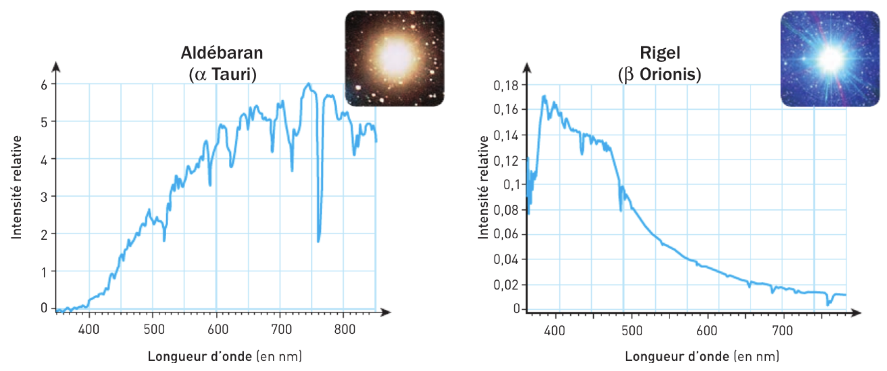

+++
title = "Soleil"
outputs = ["Reveal"]
[reveal_hugo]
theme = "black"
custom_css = "css/soleil.css"
highlight_theme = "atom-one-dark-reasonable"
+++

<!--
  Présentation « Soleil » (1ère enseignement scientifique).
  Style : static/css/soleil.css · Animations interactives : static/js/soleil/*.js
  QCM : shortcode layouts/shortcodes/qcm.html (4 propositions numérotées 1 à 4, vote aux doigts ;
  → ou « Voir la réponse » pour révéler, touches 1-4 pour surligner une proposition).
  Chaque animation se place avec :  

-->

<h1>Le Soleil</h1>

Rayonnement, couleur des étoiles et bilan radiatif de la Terre

→ avancer &nbsp;·&nbsp; ↓ sous-parties

<i data-part="intro" hidden></i>

---

{}

01<h2>Rayonnement solaire</h2>

D’où vient la puissance phénoménale du Soleil ?

<i data-part="intro" hidden></i>

---

<h3>Le Soleil, à l’échelle</h3>

---

<h3>Une étoile à 150 millions de kilomètres</h3>

---

Le Soleil, grâce à la fusion nucléaire de l’hydrogène au sein de son cœur, délivre une puissance phénoménale.

---

<h3>La fusion de l’hydrogène</h3>

---

<h3>La puissance rayonnée par le Soleil</h3>

---

L’énergie $E$ mesure la capacité à chauffer et à bouger un objet.

La puissance $P$, c’est le taux de conversion de l’énergie $E$, sa vitesse de variation.

---

On passe de l’une à l’autre grâce à la formule :

$E=P\times t$

où $E$ est en joules (J) si $P$ est en watts (W) et $t$ en secondes (s).

---

{{< qcm
    q=`La puissance du Soleil est $P\approx 3{,}85\times10^{26}\ \mathrm{W}$. Quelle énergie libère-t-il en <b>une microseconde</b> ($10^{-6}$ s) ?`
    a1=`$3{,}85\times10^{17}$ J`
    a2=`$3{,}85\times10^{20}$ J`
    a3=`$3{,}85\times10^{26}$ J`
    a4=`$3{,}85\times10^{32}$ J`
    bonne="2"
    expl=`$E=P\times t=3{,}85\times10^{26}\times10^{-6}=3{,}85\times10^{20}$ J, soit environ <b>les deux tiers de la consommation énergétique annuelle de l’humanité</b> ($\approx 6\times10^{20}$ J) en un millionième de seconde !` >}}

---

Grâce à la fameuse formule d’Einstein $E=mc^2$ qui lie la masse à l’énergie, on déduit que l’énergie libérée par le Soleil pendant une microseconde correspond à une perte de masse de $E/c^2=\ldots$

---

{{< qcm
    q=`Cette énergie ($3{,}85\times10^{20}$ J) correspond à une perte de masse $m=E/c^2$. Avec $c\approx3\times10^{8}$ m/s, on trouve environ…`
    a1=`4,3 g`
    a2=`4,3 kg`
    a3=`4,3 tonnes`
    a4=`4,3 kilotonnes`
    bonne="3"
    expl=`$m=\dfrac{E}{c^2}=\dfrac{3{,}85\times10^{20}}{(3\times10^{8})^2}\approx4{,}3\times10^{3}$ kg. Le Soleil perd donc <b>≈ 4,3 millions de tonnes de masse chaque seconde</b> (et il en a $2\times10^{30}$ kg : pas d’inquiétude pour quelques milliards d’années).` >}}

{}

---

{}

02<h2>Couleur des étoiles</h2>

La température d’une étoile se lit dans sa lumière.

<i data-part="etoiles" hidden></i>

---

Dans l’espace, deux corps peuvent échanger de l’énergie à distance via un transfert thermique radiatif.

Le corps émet alors un rayonnement électromagnétique lié à sa température (rayonnement de corps noir).

---

En effet, tout corps ayant une température supérieure au zéro absolu rayonne.

zéro absolu : 0 K = −273,15 °C

---

{{< qcm
    q=`Quand on <b>augmente la température</b> d’un corps noir, la longueur d’onde $\lambda_{max}$ du maximum de son spectre d’émission…`
    a1=`augmente`
    a2=`diminue`
    a3=`reste constante`
    a4=`augmente puis diminue`
    bonne="2"
    expl=`Plus le corps est chaud, plus son maximum d’émission se décale vers les <b>courtes longueurs d’onde</b> : il passe du rouge au jaune, puis au blanc-bleuté. Vérifions avec l’animation suivante.` >}}

---

<h3>Spectre d’un corps noir</h3>

---

La loi de Wien dit même que ces deux grandeurs sont inversement proportionnelles :

$$\lambda_{max}\propto \frac{1}{T}$$

plus précisément : $\lambda_{max}\times T\approx 2{,}89\times10^{6}\ \text{nm}\cdot\text{K}$

---

{{< qcm
    q=`D’après la loi de Wien, si on <b>double</b> la température d’une étoile, $\lambda_{max}$…`
    a1=`double`
    a2=`est divisée par 2`
    a3=`est divisée par 4`
    a4=`ne change pas`
    bonne="2"
    expl=`$\lambda_{max}\propto\dfrac1T$ : si $T$ est multipliée par 2, $\lambda_{max}$ est <b>divisée par 2</b>.` >}}

---

<h3>La constellation d’Orion</h3>

{}
Bételgeuse (supergéante rouge située à environ 500 al) en haut à gauche et Rigel (supergéante bleue environ 70 fois plus grosse que le Soleil et 40 000 fois plus lumineuse) en bas à droite. 
Betelgeuse est une des plus grandes étoiles connues. Son rayon s'étendrait entre l'orbite de Mars et Jupiter (mille fois plus grande que le Soleil !). Quand elle explosera, elle sera visible en plein jour pendant plusieurs jours avec une brillance comparable à celle de la Lune.
{}

---

{}
Aldébaran est une étoile géante orangée située dans la constellation du Taureau. Comme Bételgeuse, elle a fini de brûler son hydrogène et maintenant elle brûle son hélium. 
Pour Rigel, le maximum du spectre mesuré (≈ 385 nm) n'est que le bord de la fenêtre d'observation : le vrai maximum est dans l'ultraviolet (T ≈ 12 000 K, λmax ≈ 240 nm). On n'obtient ici qu'une température minimale.
{}

---

Trouver la température de ces deux étoiles, sachant que :

$$T(\text{en K}) = \frac{2{,}89\times10^6}{\lambda_{max}(\text{en nm})}$$

---

{{< qcm
    q=`Le spectre d’<b>Aldébaran</b> passe par un maximum vers $\lambda_{max}\approx745$ nm. Sa température de surface est d’environ…`
    a1=`390 K`
    a2=`3 900 K`
    a3=`7 700 K`
    a4=`39 000 K`
    bonne="2"
    expl=`$T=\dfrac{2{,}89\times10^{6}}{745}\approx3\,900$ K : Aldébaran est plus froide que le Soleil, ce qui explique sa couleur <b>orangée</b>.` >}}

---

Avec sa température de surface de $5778\ \text{K}$, le spectre du Soleil est centré sur le rayonnement visible.

Et la Terre rayonne dans l’infrarouge, à une longueur d’onde maximale d’environ 10 μm.

---

<h3>Soleil et Terre : deux corps noirs</h3>

---

<h3>Le spectre électromagnétique</h3>

---



---

On apprend plein de choses en analysant la lumière des étoiles :

<ul class="liste">
<li class="fragment fade-up">leur température de surface, comme on l’a vu</li>
<li class="fragment fade-up">leur composition chimique (raies d’absorption dans le spectre)</li>
<li class="fragment fade-up">leur mouvement par rapport à la Terre (décalage Doppler)</li>
<li class="fragment fade-up">la présence d’exoplanètes (transit ou effet Doppler)</li>
</ul>

---

<h3>Composition chimique : les raies</h3>

---



---

<h3>Mouvement : l’effet Doppler</h3>

---



---

<h3>Exoplanètes : transit et vitesses radiales</h3>

---

{{< qcm
    q=`Une planète géante comme <b>Jupiter</b> (rayon ≈ 1/10 de celui du Soleil) passe devant son étoile. De combien la luminosité de l’étoile baisse-t-elle ?`
    a1=`0,01 %`
    a2=`0,1 %`
    a3=`1 %`
    a4=`10 %`
    bonne="3"
    expl=`La baisse est le rapport des surfaces des disques : $\left(\dfrac{R_p}{R_\star}\right)^2\approx\left(\dfrac1{10}\right)^2=1\,\%$. Pour la Terre, ce n’est que 0,008 % : bien plus difficile à détecter !` >}}

---



{}

---

{}

03<h2>Bilan radiatif 1</h2>

L’énergie avec laquelle le Soleil arrose la Terre

<i data-part="terre" hidden></i>

---

<h3>La Terre intercepte un disque de rayons</h3>

---

La puissance solaire totale arrivant sur le sol terrestre vaut alors :

$\displaystyle 70\%\times K\times\pi R_T^2\approx \pu{1,2E17 W}$

En un an, on peut donc récupérer une énergie de :

$\pu{3,8E24 J}=\pu{3,8 YJ}$

Comparons aux autres sources d’énergie.

---

<h3>Le Soleil face aux autres sources</h3>

---

{{< qcm
    q=`L’énergie solaire reçue par la Terre en un an ($3{,}8\times10^{24}$ J) est, par rapport à la consommation énergétique mondiale annuelle ($6\times10^{20}$ J), environ…`
    a1=`6 fois plus grande`
    a2=`60 fois plus grande`
    a3=`600 fois plus grande`
    a4=`6 000 fois plus grande`
    bonne="4"
    expl=`$\dfrac{3{,}8\times10^{24}}{6\times10^{20}}\approx6\,000$ : en une heure, la Terre reçoit du Soleil plus d’énergie que l’humanité n’en consomme en une année.` >}}

---

<iframe src="https://ourworldindata.org/grapher/energy-consumption-by-source-and-country?tab=chart" loading="lazy" style="width:100%;height:600px;border:0;border-radius:18px;box-shadow:0 0 50px -10px rgba(92,200,255,.5)" allow="web-share; clipboard-write"></iframe>

---

<h3>Irradiance et distance</h3>

L’irradiance du Soleil (la puissance du rayonnement reçue sur un panneau d’un mètre carré orienté face à lui) varie en raison inverse du carré de la distance au Soleil.

$$I\propto \frac{1}{d^2}$$

---

<h3>Pourquoi 1/d² ?</h3>

---

{{< qcm
    q=`Mars est 1,5 fois plus éloignée du Soleil que la Terre. L’irradiance qu’elle reçoit est…`
    a1=`1,5 fois plus faible`
    a2=`2,3 fois plus faible`
    a3=`3,4 fois plus faible`
    a4=`1,5 fois plus forte`
    bonne="2"
    expl=`$I\propto\dfrac1{d^2}$ et $1{,}5^2\approx2{,}3$ : Mars reçoit $\dfrac{1\,361}{2{,}3}\approx590$ W/m².` >}}

---

La trajectoire de la Terre autour du Soleil n’est pas tout à fait circulaire ; elle est elliptique.

L’excentricité de cette ellipse est néanmoins très faible.

---



---

<h3>Faisons varier l’excentricité</h3>

---

<b class="imp">On ne peut pas expliquer les saisons par la variation de la distance Terre-Soleil !</b>

Comment les expliquer alors ?

Les saisons sont dues à l’inclinaison de la Terre !

---

<h3>Irradiance et inclinaison</h3>

Le rayonnement solaire ne touche pas aussi efficacement toute la surface terrestre : l’inclinaison des rayons par rapport à la surface modifie la puissance par m² reçue.

---

<h3>Inclinaison des rayons et irradiance</h3>

---

{{< qcm
    q=`Quand le Soleil est à <b>30°</b> au-dessus de l’horizon, un faisceau de 1 m² de section éclaire au sol une surface de…`
    a1=`0,5 m²`
    a2=`1 m²`
    a3=`2 m²`
    a4=`4 m²`
    bonne="3"
    expl=`$S=\dfrac1{\sin h}=\dfrac1{\sin30^\circ}=2$ m² : la puissance reçue par m² est <b>divisée par 2</b> ($I=K\sin h\approx680$ W/m²).` >}}

---

<h3>Éclairement selon la latitude</h3>

---

Sans surprise, il y a un maximum d’énergie reçue au niveau de l’équateur et un minimum au niveau des pôles.

Les températures moyennes au sol suivent logiquement (mais pas parfaitement) ce gradient de l’équateur aux pôles.

---

---

Regardons maintenant comment évolue l’irradiation au cours de l’année.

---

<h3>L’éclairement au fil de l’année</h3>

---

Comment expliquer ces variations saisonnières ?

C’est là que l’inclinaison de l’axe de rotation de la Terre entre en jeu.

---

<h3>Orbite, axe incliné et saisons</h3>

---

L’élévation (ou hauteur) du Soleil est l’angle (compris entre 0° et 90°) entre les rayons du Soleil et le sol.

---

<h3>Trajectoire du Soleil et élévation</h3>

---

Au cours d’une journée, l’élévation du Soleil est bien sûr maximale à midi.

On parle ici du midi solaire (moment où le Soleil est à son zénith) qui peut être décalé par rapport au midi administratif.

---

Au cours de l’année, l’élévation du Soleil est maximale dans l’hémisphère Nord le jour du solstice d’été (autour du 21 juin).

Et minimale le jour du solstice d’hiver (autour du 21 décembre).

---

{{< qcm
    q=`À <b>Paris</b> (latitude ≈ 49° N), quelle est l’élévation maximale du Soleil le <b>21 juin</b> ? (le 21 juin, le Soleil est à 23,4° au-dessus de l’équateur céleste)`
    a1=`23°`
    a2=`41°`
    a3=`65°`
    a4=`90°`
    bonne="3"
    expl=`$h_{max}=90^\circ-\text{latitude}+\delta=90-49+23{,}4\approx65^\circ$. Le 21 décembre, ce serait $90-49-23{,}4\approx18^\circ$ seulement.` >}}

---

La durée du jour au cours de l’année est en lien direct avec l’élévation du Soleil.

---

<h3>Durée du jour selon la latitude et la date</h3>

{}

---

{}

04<h2>Bilan radiatif 2</h2>

Ce qui repart dans l’espace… et l’effet de serre

<i data-part="serre" hidden></i>

---



---

La vidéo précédente montre l’irradiation solaire au niveau du sol.

Comment expliquer la différence par rapport à l’irradiation au niveau des hautes couches atmosphériques (beaucoup plus symétrique) ?

---

<h3>Irradiation au sommet de l’atmosphère</h3>

---

L’albédo est la proportion de rayonnement renvoyée par une surface.

$$A = \frac{P_{diff}}{P_{inc}}$$

---

<h3>L’albédo de quelques surfaces</h3>

---

{{< qcm
    q=`Une surface de <b>neige fraîche</b> (albédo $A=0{,}85$) reçoit 1 000 W/m². Quelle puissance <b>absorbe</b>-t-elle par m² ?`
    a1=`85 W`
    a2=`150 W`
    a3=`850 W`
    a4=`1 000 W`
    bonne="2"
    expl=`$P_{abs}=(1-A)\times P_{inc}=0{,}15\times1\,000=150$ W/m² : la neige renvoie $850$ W/m² et reste froide.` >}}

---

Grâce à sa couverture nuageuse, l’albédo de la Terre est relativement élevé (de 30 à 35 %) quand celui de la Lune vaut 7 %…

---

---



---

La Terre étant chauffée par le Soleil, elle émet, comme on l’a vu, un rayonnement de corps noir déterminé par sa température de surface moyenne.

Ce rayonnement est situé dans l’infrarouge (autour de 10 μm).

---

<h3>Effet de serre</h3>

Il se trouve que certains gaz atmosphériques, les gaz à effet de serre (comme le dioxyde de carbone, le méthane ou la vapeur d’eau), sont opaques à ces longueurs d’onde.

---

<h3>Quels gaz absorbent l’infrarouge ?</h3>

---

<h3>Le bilan radiatif de la Terre</h3>

---

Les gaz à effet de serre renvoient vers la surface une partie du rayonnement infrarouge émis par la Terre.

---

{{< qcm
    q=`L’effet de serre est dû à des gaz qui…`
    a1=`absorbent le rayonnement solaire visible`
    a2=`absorbent le rayonnement infrarouge émis par la Terre et en renvoient une partie vers le sol`
    a3=`réfléchissent tout le rayonnement solaire`
    a4=`produisent eux-mêmes de la chaleur`
    bonne="2"
    expl=`Les gaz à effet de serre sont <b>transparents au visible</b> mais <b>opaques à l’infrarouge</b> : ils réémettent une partie de ce rayonnement vers la surface (le « contre-rayonnement », 333 W/m²).` >}}

---

Si la quantité de gaz à effet de serre augmente, une partie du budget radiatif est déséquilibré (il y a plus d’énergie entrante que sortante). On parle de forçage radiatif.

La température de surface augmente alors (entraînant un plus fort flux sortant) jusqu’à ce que l’équilibre soit rétabli.

---



---

<h3>Un modèle d’effet de serre</h3>

---



{}

---

<a href="https://coursphychi.github.io/1es/soleil/">↩ Retour au site</a>

