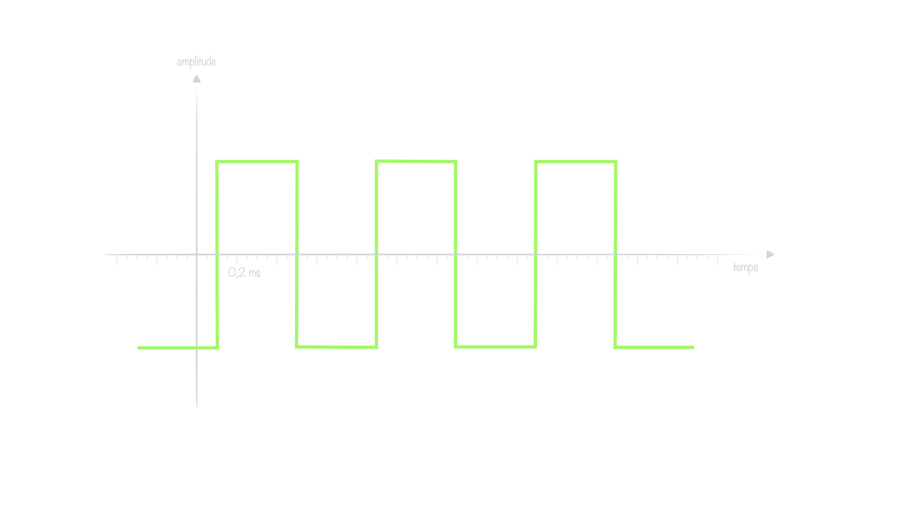
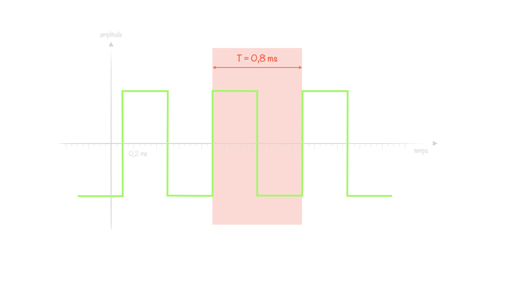
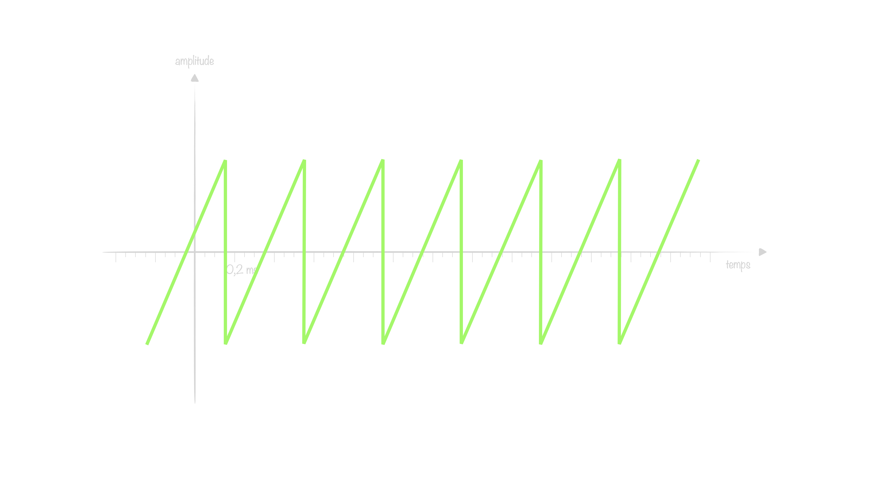
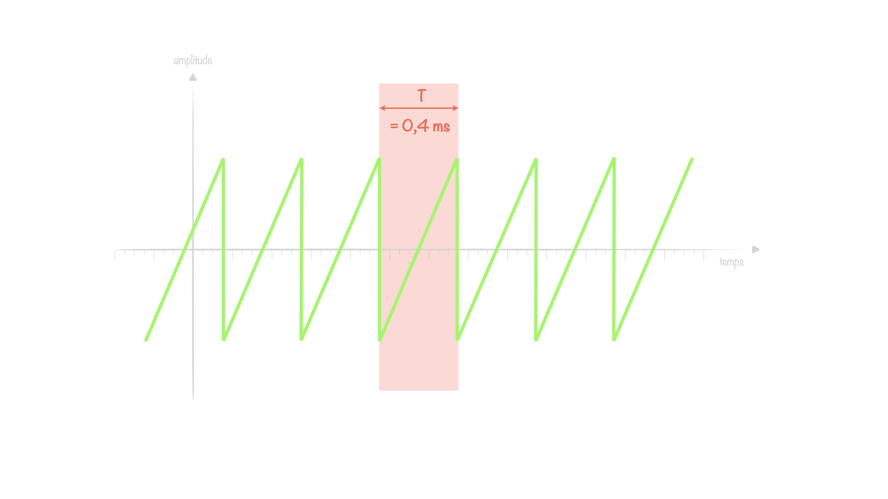

+++
title = "Son"
outputs = ["Reveal"]
son_css = "css/son.css"
[reveal_hugo]
theme = "black"
highlight_theme = "atom-one-dark-reasonable"
+++

<!--
  Présentation « Son » (2nde).
  Style    : static/css/son.css
  Scripts  : static/js/son/core.js (ambiance par partie, votes, boîte à outils)
             static/js/son/widgets.js (animations interactives)
  Widgets  : 

  Votes    : shortcode qcm (2 à 4 propositions). Touches 1 à 4 ou clic sur une carte = un vote
             (Maj + touche = retirer un vote) ; → ou « Voir la réponse » = correction.
  Cellule à révéler au clic : <td class="rv" data-v="réponse">?</td>
  Question posée à la classe : …
  Boîte à outils (bas à gauche) : 🎲 tirage au sort · ⏱️ minuteur · 🔴 pointeur laser
-->

<i></i><i></i><i></i><i></i><i></i><i></i><i></i><i></i><i></i><i></i><i></i><i></i><i></i>

<h1>Le Son</h1>

Émission, propagation et perception

↓ sous-parties &nbsp;·&nbsp; 🎲 ⏱️ 🔴 boîte à outils en bas à gauche

---

{}

<i data-part="emission" hidden></i>
01
<h2>Émission et perception d'un son</h2>

Comment naît un son et comment voyage-t-il ?

---



---

Le son est produit par une vibration qui se propage de proche en proche dans un milieu matériel.

Les particules du milieu lui-même 
    ne font qu'osciller sur place.

---

{}
Une source pulsante émet une onde qui se propage radialement : chaque particule oscille sur place, c'est la perturbation qui voyage de proche en proche. Couleur et brillance = compression locale ; les anneaux marquent les crêtes de compression. Cliquer pour mettre en pause.
{}

---

On est en présence d'une onde (l'onde sonore) caractérisée par un  transport d'énergie et d'information sans qu'il y ait transport de matière.

---



---



Sans milieu matériel, pas de son !

$\Rightarrow$ Le vide spatial est silencieux.

{}
Pas de feu non plus d'ailleurs...
{}

---

Et la vitesse du signal sonore dépend du milieu.

---



{}
Vote aux doigts : les élèves lèvent 1, 2, 3 ou 4 doigts. Appuyer sur 1-4 (ou cliquer sur une carte) pour compter les votes, puis → pour la correction.
{}

---



---

<h3>Voyons-le à l'échelle des particules</h3>

{}
Changer de milieu : la particule rouge ne fait qu'osciller sur place, c'est l'onde (le front en pointillés) qui avance. Dans le vide, il n'y a rien pour transmettre la vibration. Les vitesses affichées sont à l'échelle (rapport 1 : 4,4 : 17) mais la fréquence de la source est très basse pour que l'on voie le mouvement.
{}

---

<table class="vit">
<tr><th>milieu</th><td>air</td><td>eau</td><td>acier</td></tr>
<tr class="v"><th>vitesse du son (m/s)</th><td>340</td><td>1500</td><td>5800</td></tr>
</table>

Comment convertir ces vitesses en km/h&nbsp;?

---

Commençons par convertir des km/h en m/s en prenant l'exemple de $\pu{72 km/h}$ :

$\pu{72 km/h}$ $\displaystyle =\frac{\pu{72 km}}{\pu{1 h}}$  $\displaystyle= \frac{\pu{72E3 m}}{\pu{3600 s}}$ $\displaystyle=\frac{\pu{72E3 m}}{\pu{3,6E3 s}}$ 

$$\Rightarrow \pu{72 km/h}=\frac{72}{\color{#E22146}{3,6}}\pu{ m/s}=\pu{20 m/s}$$

---

Il faut donc diviser par 3,6 pour passer des km/h aux m/s.

Que doit-on alors faire pour passer des m/s aux km/h&nbsp;?

<svg style="display:block;width:100%;height:auto;overflow:visible" viewBox="0 -20 760 380" role="img" aria-label="Pour passer des km/h aux m/s on divise par 3,6, pour passer des m/s aux km/h on multiplie par 3,6">
<defs>
<linearGradient id="gb" x1="0" y1="0" x2="1" y2="1"><stop offset="0" stop-color="#2aa6ee"/><stop offset="1" stop-color="#0063a0"/></linearGradient>
<linearGradient id="gg" x1="0" y1="0" x2="1" y2="1"><stop offset="0" stop-color="#3fdc22"/><stop offset="1" stop-color="#138a00"/></linearGradient>
</defs>
<g class="pill"><rect x="20" y="130" width="230" height="90" rx="45" fill="url(#gb)"/><text x="135" y="191" text-anchor="middle" fill="#fff" font-family="Outfit, sans-serif" font-weight="800" font-size="46">km/h</text></g>
<g class="pill"><rect x="510" y="130" width="230" height="90" rx="45" fill="url(#gg)"/><text x="625" y="191" text-anchor="middle" fill="#fff" font-family="Outfit, sans-serif" font-weight="800" font-size="46">m/s</text></g>
<g class="top">
<path class="arc" pathLength="1" fill="none" stroke="#ff644e" stroke-width="7" stroke-linecap="round" d="M135 126 C135 -10 625 -10 625 100"/>
<polygon class="head" points="625,128 610,100 640,100" fill="#ff644e"/>
<g class="lab"><rect x="305" y="-6" width="150" height="56" rx="28" fill="#ff644e"/><text x="380" y="33" text-anchor="middle" fill="#fff" font-family="Outfit, sans-serif" font-weight="800" font-size="34">÷ 3,6</text></g>
</g>
<g class="bot fragment">
<path class="arc" pathLength="1" fill="none" stroke="#ffc43a" stroke-width="7" stroke-linecap="round" d="M625 224 C625 358 135 358 135 252"/>
<polygon class="head" points="135,222 120,252 150,252" fill="#ffc43a"/>
<g class="lab"><rect x="305" y="300" width="150" height="56" rx="28" fill="#ffc43a"/><text x="380" y="339" text-anchor="middle" fill="#1b1300" font-family="Outfit, sans-serif" font-weight="800" font-size="34">× 3,6</text></g>
</g>
</svg>

---

<table class="vit">
<tr><th>milieu</th><td>air</td><td>eau</td><td>acier</td></tr>
<tr class="v"><th>vitesse du son (m/s)</th><td>340</td><td>1500</td><td>5800</td></tr>
<tr class="kmh"><th>vitesse du son (km/h)</th><td class="rv" data-v="1&#8239;224">?</td><td class="rv" data-v="5&#8239;400">?</td><td class="rv" data-v="20&#8239;880">?</td></tr>
</table>

À vous&nbsp;! Convertissez, puis cliquez sur chaque «&nbsp;?&nbsp;» pour vérifier.

---

Rappel :

En appelant $d$ la distance parcourue (en m) et $\Delta t$ la durée écoulée (en s), la vitesse $v$ d'un signal est donnée par la relation :

$$v = \frac{d}{\Delta t}$$

---

<u>Rq :</u>

On écrit $\Delta t$ car une durée est l'écart entre deux instants et le symbole $\Delta$ (Delta) symbolise, en physique, un écart : $\Delta t = t_{final} - t_{initial}$.

Symétriquement, on peut aussi considérer la distance comme un écart entre deux positions et au lieu de $d$, on aurait pu écrire $\Delta x$.

---

Si on connaît la vitesse et la durée, comment obtient-on la distance&nbsp;?

$$d=v\times \Delta t$$

---

Et si on connaît la distance et la vitesse, comment obtient-on la durée&nbsp;?

$$\Delta t = \frac{d}{v}$$

---

<h3>La course du son</h3>

{}
Laisser les élèves estimer Δt avant l'arrivée de chaque point (distance au choix avec le curseur). La durée du trajet de l'air est affichée en accéléré (7 s), les autres milieux gardent les bons rapports de vitesse.
{}

---

{}
L'éclair est une vidéo locale (static/eclair.mp4 et eclair.webm, convertie depuis le gif d'origine) : elle ne se joue qu'une fois puis reste figée sur sa dernière image ; le tonnerre retentit seul 2 secondes après la fin.
Réglage dans la balise ci-dessus : data-delay (secondes entre la fin de la vidéo et le tonnerre).
{}

---

Pourquoi doit-on compter approximativement 3 s par km entre l'éclair et le tonnerre&nbsp;?

{}
Régler la distance de l'orage, cliquer sur « Éclair ! » et faire compter les élèves à voix haute jusqu'au tonnerre. Le chronomètre affiche ensuite la valeur calculée avec Δt = d / v.
{}

---



Qu'est-ce que cette vidéo nous permet de déterminer&nbsp;?

---

<iframe src="https://podeduc.apps.education.fr/video/20160-eruption-du-volcan-tavurvur-en-papouasie-nouvelle-guinee/?is_iframe=true" width="640" height="360" style="padding: 0; margin: 0; border:0;border-radius:10px;" allowfullscreen title="Eruption du volcan Tavurvur en Papouasie Nouvelle Guinée" ></iframe>

---



{}

---



<i data-part="periode" hidden></i>

---

{}

<i data-part="periode" hidden></i>
02
<h2>Signal sonore périodique</h2>

Comment décrire les sons musicaux&nbsp;?

---

Les sons musicaux sont des signaux périodiques.

Un signal périodique est un signal qui se répète à l'identique dans le temps.

La période $T$ d'un signal périodique est la durée d'une répétition (d'un motif).

Unité : la seconde

---



---



---



{}
Reproduction animée du gif : la bande rouge (une période) glisse le long du signal, on découpe le signal en 4 périodes identiques, puis on les superpose : elles coïncident exactement. Cliquer sur l'animation pour la mettre en pause.
{}

---

Que vaut la période de ce signal&nbsp;?

---

Que vaut la période de ce signal&nbsp;?

---

Pour des sons musicaux, la période est souvent très petite, de l'ordre de la cs ou ms. On lui préfère alors le nombre de répétitions (de motifs) par seconde qui est l'inverse de la période et qu'on appelle la fréquence $f$.

$$f = \frac{1}{T}$$

Unité : le hertz (Hz)

---

<h3>Une oscillation et son signal</h3>

---



---

Quelle est la période et la fréquence de ce signal&nbsp;?

<canvas id="myCanvas" width="500" height="500" style="width:340px;height:340px;flex:none;"></canvas>

{}
5,3 secondes théoriquement
Faire mesurer sur une période puis sur 10 périodes.
Le chronomètre démarre au premier « Top » et s'arrête au second ; l'animation demande alors combien de périodes se sont écoulées et calcule T = Δt / N. Comparer une mesure sur 1 période et sur 10 périodes : l'incertitude affichée (≈ 0,2 s de temps de réaction, divisée par N) montre qu'un grand nombre de périodes donne une mesure plus précise.
{}

---



---

<h3>Mesurons notre fréquence cardiaque</h3>

{}

---

{}

<i data-part="perception" hidden></i>
03
<h2>Perception d'un son</h2>

Hauteur, timbre, intensité&nbsp;: que perçoit-on&nbsp;?

---

<h3>Générateur de sons</h3>

{}
- piège de bien mesurer entre deux couleurs identiques
- Permet de parler de comment améliorer la précision lorsque phénomène répétitif :mesurer un nombre n de répétitions puis diviser le résultat par n (l'unique mesure a théoriquement la même précision que l'on mesure 1 ou 10 périodes mais par contre, dans le cas de 10, on divise cette précision d'une mesure unique par 10. Donc la mesure est 10 fois meilleure !)
- Défi classe : monter la fréquence jusqu'à ce que les élèves n'entendent plus rien (levez la main quand vous n'entendez plus !). Les plus âgés perdent les aigus en premier. Prévenir du volume avant de lancer le son.
- Changer la forme du signal : la hauteur (donc la période) ne change pas mais le son n'est plus le même, ce qui prépare la notion de timbre.
{}

---

Le domaine des fréquences des sons audibles pour l'oreille humaine est situé entre&nbsp;20&nbsp;et&nbsp;20000&nbsp;Hz.

<svg viewBox="0 0 960 270" role="img" aria-label="Spectre sonore : infrasons sous 20 Hz, sons audibles de 20 Hz à 20 000 Hz, ultrasons au-dessus" style="display:block;width:100%;height:auto;overflow:visible">
<defs>
<linearGradient id="spi" x1="0" y1="0" x2="1" y2="0"><stop offset="0" stop-color="#ff9a5c"/><stop offset="1" stop-color="#ff4d6d"/></linearGradient>
<linearGradient id="spa" x1="0" y1="0" x2="1" y2="0"><stop offset="0" stop-color="#3fe58a"/><stop offset="1" stop-color="#37d6ff"/></linearGradient>
<linearGradient id="spu" x1="0" y1="0" x2="1" y2="0"><stop offset="0" stop-color="#4aa8ff"/><stop offset="1" stop-color="#8a6dff"/></linearGradient>
<clipPath id="cpi"><rect x="30" y="100" width="266" height="80" rx="16"/></clipPath>
<clipPath id="cpa"><rect x="304" y="100" width="352" height="80" rx="16"/></clipPath>
<clipPath id="cpu"><rect x="664" y="100" width="266" height="80" rx="16"/></clipPath>
</defs>
<g class="zone z1"><rect x="30" y="100" width="266" height="80" rx="16" fill="url(#spi)"/><g clip-path="url(#cpi)"><path class="onde o1" style="--lam:180.0px" d="M30.0 140.0 L32.0 138.5 L34.0 136.9 L36.0 135.4 L38.0 133.9 L40.0 132.5 L42.0 131.1 L44.0 129.7 L46.0 128.3 L48.0 127.1 L50.0 125.9 L52.0 124.7 L54.0 123.7 L56.0 122.7 L58.0 121.8 L60.0 120.9 L62.0 120.2 L64.0 119.6 L66.0 119.1 L68.0 118.7 L70.0 118.3 L72.0 118.1 L74.0 118.0 L76.0 118.0 L78.0 118.1 L80.0 118.3 L82.0 118.7 L84.0 119.1 L86.0 119.6 L88.0 120.2 L90.0 120.9 L92.0 121.8 L94.0 122.7 L96.0 123.7 L98.0 124.7 L100.0 125.9 L102.0 127.1 L104.0 128.3 L106.0 129.7 L108.0 131.1 L110.0 132.5 L112.0 133.9 L114.0 135.4 L116.0 136.9 L118.0 138.5 L120.0 140.0 L122.0 141.5 L124.0 143.1 L126.0 144.6 L128.0 146.1 L130.0 147.5 L132.0 148.9 L134.0 150.3 L136.0 151.7 L138.0 152.9 L140.0 154.1 L142.0 155.3 L144.0 156.3 L146.0 157.3 L148.0 158.2 L150.0 159.1 L152.0 159.8 L154.0 160.4 L156.0 160.9 L158.0 161.3 L160.0 161.7 L162.0 161.9 L164.0 162.0 L166.0 162.0 L168.0 161.9 L170.0 161.7 L172.0 161.3 L174.0 160.9 L176.0 160.4 L178.0 159.8 L180.0 159.1 L182.0 158.2 L184.0 157.3 L186.0 156.3 L188.0 155.3 L190.0 154.1 L192.0 152.9 L194.0 151.7 L196.0 150.3 L198.0 148.9 L200.0 147.5 L202.0 146.1 L204.0 144.6 L206.0 143.1 L208.0 141.5 L210.0 140.0 L212.0 138.5 L214.0 136.9 L216.0 135.4 L218.0 133.9 L220.0 132.5 L222.0 131.1 L224.0 129.7 L226.0 128.3 L228.0 127.1 L230.0 125.9 L232.0 124.7 L234.0 123.7 L236.0 122.7 L238.0 121.8 L240.0 120.9 L242.0 120.2 L244.0 119.6 L246.0 119.1 L248.0 118.7 L250.0 118.3 L252.0 118.1 L254.0 118.0 L256.0 118.0 L258.0 118.1 L260.0 118.3 L262.0 118.7 L264.0 119.1 L266.0 119.6 L268.0 120.2 L270.0 120.9 L272.0 121.8 L274.0 122.7 L276.0 123.7 L278.0 124.7 L280.0 125.9 L282.0 127.1 L284.0 128.3 L286.0 129.7 L288.0 131.1 L290.0 132.5 L292.0 133.9 L294.0 135.4 L296.0 136.9 L298.0 138.5 L300.0 140.0 L302.0 141.5 L304.0 143.1 L306.0 144.6 L308.0 146.1 L310.0 147.5 L312.0 148.9 L314.0 150.3 L316.0 151.7 L318.0 152.9 L320.0 154.1 L322.0 155.3 L324.0 156.3 L326.0 157.3 L328.0 158.2 L330.0 159.1 L332.0 159.8 L334.0 160.4 L336.0 160.9 L338.0 161.3 L340.0 161.7 L342.0 161.9 L344.0 162.0 L346.0 162.0 L348.0 161.9 L350.0 161.7 L352.0 161.3 L354.0 160.9 L356.0 160.4 L358.0 159.8 L360.0 159.1 L362.0 158.2 L364.0 157.3 L366.0 156.3 L368.0 155.3 L370.0 154.1 L372.0 152.9 L374.0 151.7 L376.0 150.3 L378.0 148.9 L380.0 147.5 L382.0 146.1 L384.0 144.6 L386.0 143.1 L388.0 141.5 L390.0 140.0 L392.0 138.5 L394.0 136.9 L396.0 135.4 L398.0 133.9 L400.0 132.5 L402.0 131.1 L404.0 129.7 L406.0 128.3 L408.0 127.1 L410.0 125.9 L412.0 124.7 L414.0 123.7 L416.0 122.7 L418.0 121.8 L420.0 120.9 L422.0 120.2 L424.0 119.6 L426.0 119.1 L428.0 118.7 L430.0 118.3 L432.0 118.1 L434.0 118.0 L436.0 118.0 L438.0 118.1 L440.0 118.3 L442.0 118.7 L444.0 119.1 L446.0 119.6 L448.0 120.2 L450.0 120.9 L452.0 121.8 L454.0 122.7 L456.0 123.7 L458.0 124.7 L460.0 125.9 L462.0 127.1 L464.0 128.3 L466.0 129.7 L468.0 131.1 L470.0 132.5 L472.0 133.9 L474.0 135.4 L476.0 136.9 L478.0 138.5 L480.0 140.0 L482.0 141.5" fill="none" stroke="#fff" stroke-opacity=".28" stroke-width="3" stroke-linecap="round" stroke-linejoin="round"/></g><text x="163" y="152" text-anchor="middle" fill="#fff" font-family="Outfit, sans-serif" font-weight="800" font-size="34" paint-order="stroke" stroke="rgba(0,0,0,.25)" stroke-width="4">infrasons</text></g>
<g class="zone z2"><rect x="304" y="100" width="352" height="80" rx="16" fill="url(#spa)"/><g clip-path="url(#cpa)"><path class="onde o2" style="--lam:60.0px" d="M300.0 140.0 L302.0 135.4 L304.0 131.1 L306.0 127.1 L308.0 123.7 L310.0 120.9 L312.0 119.1 L314.0 118.1 L316.0 118.1 L318.0 119.1 L320.0 120.9 L322.0 123.7 L324.0 127.1 L326.0 131.1 L328.0 135.4 L330.0 140.0 L332.0 144.6 L334.0 148.9 L336.0 152.9 L338.0 156.3 L340.0 159.1 L342.0 160.9 L344.0 161.9 L346.0 161.9 L348.0 160.9 L350.0 159.1 L352.0 156.3 L354.0 152.9 L356.0 148.9 L358.0 144.6 L360.0 140.0 L362.0 135.4 L364.0 131.1 L366.0 127.1 L368.0 123.7 L370.0 120.9 L372.0 119.1 L374.0 118.1 L376.0 118.1 L378.0 119.1 L380.0 120.9 L382.0 123.7 L384.0 127.1 L386.0 131.1 L388.0 135.4 L390.0 140.0 L392.0 144.6 L394.0 148.9 L396.0 152.9 L398.0 156.3 L400.0 159.1 L402.0 160.9 L404.0 161.9 L406.0 161.9 L408.0 160.9 L410.0 159.1 L412.0 156.3 L414.0 152.9 L416.0 148.9 L418.0 144.6 L420.0 140.0 L422.0 135.4 L424.0 131.1 L426.0 127.1 L428.0 123.7 L430.0 120.9 L432.0 119.1 L434.0 118.1 L436.0 118.1 L438.0 119.1 L440.0 120.9 L442.0 123.7 L444.0 127.1 L446.0 131.1 L448.0 135.4 L450.0 140.0 L452.0 144.6 L454.0 148.9 L456.0 152.9 L458.0 156.3 L460.0 159.1 L462.0 160.9 L464.0 161.9 L466.0 161.9 L468.0 160.9 L470.0 159.1 L472.0 156.3 L474.0 152.9 L476.0 148.9 L478.0 144.6 L480.0 140.0 L482.0 135.4 L484.0 131.1 L486.0 127.1 L488.0 123.7 L490.0 120.9 L492.0 119.1 L494.0 118.1 L496.0 118.1 L498.0 119.1 L500.0 120.9 L502.0 123.7 L504.0 127.1 L506.0 131.1 L508.0 135.4 L510.0 140.0 L512.0 144.6 L514.0 148.9 L516.0 152.9 L518.0 156.3 L520.0 159.1 L522.0 160.9 L524.0 161.9 L526.0 161.9 L528.0 160.9 L530.0 159.1 L532.0 156.3 L534.0 152.9 L536.0 148.9 L538.0 144.6 L540.0 140.0 L542.0 135.4 L544.0 131.1 L546.0 127.1 L548.0 123.7 L550.0 120.9 L552.0 119.1 L554.0 118.1 L556.0 118.1 L558.0 119.1 L560.0 120.9 L562.0 123.7 L564.0 127.1 L566.0 131.1 L568.0 135.4 L570.0 140.0 L572.0 144.6 L574.0 148.9 L576.0 152.9 L578.0 156.3 L580.0 159.1 L582.0 160.9 L584.0 161.9 L586.0 161.9 L588.0 160.9 L590.0 159.1 L592.0 156.3 L594.0 152.9 L596.0 148.9 L598.0 144.6 L600.0 140.0 L602.0 135.4 L604.0 131.1 L606.0 127.1 L608.0 123.7 L610.0 120.9 L612.0 119.1 L614.0 118.1 L616.0 118.1 L618.0 119.1 L620.0 120.9 L622.0 123.7 L624.0 127.1 L626.0 131.1 L628.0 135.4 L630.0 140.0 L632.0 144.6 L634.0 148.9 L636.0 152.9 L638.0 156.3 L640.0 159.1 L642.0 160.9 L644.0 161.9 L646.0 161.9 L648.0 160.9 L650.0 159.1 L652.0 156.3 L654.0 152.9 L656.0 148.9 L658.0 144.6 L660.0 140.0 L662.0 135.4 L664.0 131.1 L666.0 127.1 L668.0 123.7 L670.0 120.9 L672.0 119.1 L674.0 118.1 L676.0 118.1 L678.0 119.1 L680.0 120.9 L682.0 123.7 L684.0 127.1 L686.0 131.1 L688.0 135.4 L690.0 140.0 L692.0 144.6 L694.0 148.9 L696.0 152.9 L698.0 156.3 L700.0 159.1 L702.0 160.9 L704.0 161.9 L706.0 161.9 L708.0 160.9 L710.0 159.1 L712.0 156.3 L714.0 152.9 L716.0 148.9 L718.0 144.6 L720.0 140.0 L722.0 135.4" fill="none" stroke="#fff" stroke-opacity=".28" stroke-width="3" stroke-linecap="round" stroke-linejoin="round"/></g><text x="480" y="152" text-anchor="middle" fill="#fff" font-family="Outfit, sans-serif" font-weight="800" font-size="38" paint-order="stroke" stroke="rgba(0,0,0,.25)" stroke-width="4">sons audibles</text></g>
<g class="zone z3"><rect x="664" y="100" width="266" height="80" rx="16" fill="url(#spu)"/><g clip-path="url(#cpu)"><path class="onde o3" style="--lam:15.0px" d="M660.0 140.0 L662.0 126.6 L664.0 122.1 L666.0 129.4 L668.0 143.7 L670.0 155.6 L672.0 157.1 L674.0 147.3 L676.0 132.7 L678.0 122.9 L680.0 124.4 L682.0 136.3 L684.0 150.6 L686.0 157.9 L688.0 153.4 L690.0 140.0 L692.0 126.6 L694.0 122.1 L696.0 129.4 L698.0 143.7 L700.0 155.6 L702.0 157.1 L704.0 147.3 L706.0 132.7 L708.0 122.9 L710.0 124.4 L712.0 136.3 L714.0 150.6 L716.0 157.9 L718.0 153.4 L720.0 140.0 L722.0 126.6 L724.0 122.1 L726.0 129.4 L728.0 143.7 L730.0 155.6 L732.0 157.1 L734.0 147.3 L736.0 132.7 L738.0 122.9 L740.0 124.4 L742.0 136.3 L744.0 150.6 L746.0 157.9 L748.0 153.4 L750.0 140.0 L752.0 126.6 L754.0 122.1 L756.0 129.4 L758.0 143.7 L760.0 155.6 L762.0 157.1 L764.0 147.3 L766.0 132.7 L768.0 122.9 L770.0 124.4 L772.0 136.3 L774.0 150.6 L776.0 157.9 L778.0 153.4 L780.0 140.0 L782.0 126.6 L784.0 122.1 L786.0 129.4 L788.0 143.7 L790.0 155.6 L792.0 157.1 L794.0 147.3 L796.0 132.7 L798.0 122.9 L800.0 124.4 L802.0 136.3 L804.0 150.6 L806.0 157.9 L808.0 153.4 L810.0 140.0 L812.0 126.6 L814.0 122.1 L816.0 129.4 L818.0 143.7 L820.0 155.6 L822.0 157.1 L824.0 147.3 L826.0 132.7 L828.0 122.9 L830.0 124.4 L832.0 136.3 L834.0 150.6 L836.0 157.9 L838.0 153.4 L840.0 140.0 L842.0 126.6 L844.0 122.1 L846.0 129.4 L848.0 143.7 L850.0 155.6 L852.0 157.1 L854.0 147.3 L856.0 132.7 L858.0 122.9 L860.0 124.4 L862.0 136.3 L864.0 150.6 L866.0 157.9 L868.0 153.4 L870.0 140.0 L872.0 126.6 L874.0 122.1 L876.0 129.4 L878.0 143.7 L880.0 155.6 L882.0 157.1 L884.0 147.3 L886.0 132.7 L888.0 122.9 L890.0 124.4 L892.0 136.3 L894.0 150.6 L896.0 157.9 L898.0 153.4 L900.0 140.0 L902.0 126.6 L904.0 122.1 L906.0 129.4 L908.0 143.7 L910.0 155.6 L912.0 157.1 L914.0 147.3 L916.0 132.7 L918.0 122.9 L920.0 124.4 L922.0 136.3 L924.0 150.6 L926.0 157.9 L928.0 153.4 L930.0 140.0 L932.0 126.6 L934.0 122.1 L936.0 129.4 L938.0 143.7 L940.0 155.6 L942.0 157.1 L944.0 147.3 L946.0 132.7" fill="none" stroke="#fff" stroke-opacity=".28" stroke-width="3" stroke-linecap="round" stroke-linejoin="round"/></g><text x="797" y="152" text-anchor="middle" fill="#fff" font-family="Outfit, sans-serif" font-weight="800" font-size="34" paint-order="stroke" stroke="rgba(0,0,0,.25)" stroke-width="4">ultrasons</text></g>
<g class="axe"><line x1="30" y1="214" x2="918" y2="214" stroke="#d5dcff" stroke-opacity=".85" stroke-width="3" stroke-linecap="round"/><polygon points="944,214 918,202 918,226" fill="#d5dcff" fill-opacity=".9"/><text x="944" y="252" text-anchor="end" fill="#a9b2d6" font-family="Outfit, sans-serif" font-weight="300" font-size="26" font-style="italic">f (Hz)</text></g>
<g class="borne b1"><line x1="300" y1="78" x2="300" y2="222" stroke="#fff" stroke-opacity=".9" stroke-width="3" stroke-dasharray="2 7" stroke-linecap="round"/><circle cx="300" cy="214" r="7" fill="#fff"/><text x="300" y="62" text-anchor="middle" fill="#fff" font-family="Outfit, sans-serif" font-weight="600" font-size="34">20 Hz</text></g>
<g class="borne b2"><line x1="660" y1="78" x2="660" y2="222" stroke="#fff" stroke-opacity=".9" stroke-width="3" stroke-dasharray="2 7" stroke-linecap="round"/><circle cx="660" cy="214" r="7" fill="#fff"/><text x="660" y="62" text-anchor="middle" fill="#fff" font-family="Outfit, sans-serif" font-weight="600" font-size="34">20 000 Hz</text></g>
</svg>

{}
Tous les animaux pareils ?
+ Vieillesse ou détérioration
{}

---

Pour un son musical, la hauteur désigne la note jouée (plus ou moins grave ou aigüe).

<b>La hauteur est liée à la fréquence</b> : 
plus la fréquence est grande, plus la hauteur est grande et plus la note est aigüe.

---

Le signal de deux notes identiques jouées par des instruments différents possède la même période mais la forme des signaux est différente.

On appelle timbre ce qui distingue deux notes de même hauteur.

---

<iframe width=550 height=440 src="https://www.edumedia-sciences.com/fr/media/frame/320/?auth=8c1ba56b82bdf81fef2eb4ff1c4b50c7/27824" frameborder=0></iframe>

{}
https://www.edumedia-sciences.com/fr/media/frame/320/?auth=8c1ba56b82bdf81fef2eb4ff1c4b50c7/27824
{}

---

Enfin, la troisième caractéristique d'un son est son intensité.

L'intensité sonore est liée à l'amplitude du signal.

---



---

Pour augmenter l'intensité du son émis, beaucoup d’instruments et d’êtres vivants sont dotés d’une caisse de résonance   qui amplifie et sélectionne les sons.

---



---



---



---



---



---



---



---

Si l'intensité sonore de la trompette seule vaut $I_1$ à une certaine distance, alors l'intensité des 4 trompettes jouées ensemble vaudra $4I_1$ à la même distance.

---

Mais cette relation de proportionnalité rend mal compte de notre sensation auditive.

On peut par exemple mesurer que l'<b>intensité sonore</b> du son émis par quelqu'un qui parle fort est environ 10&nbsp;000 fois plus grande que celle d'une personne qui chuchote à la même distance ! Pourtant, on n'a pas la sensation d'un son 10&nbsp;000 fois plus fort...

Intensité sonore et sensation auditive ne sont pas proportionnelles&nbsp;!

{}
70dB pour parler fort
30dB pour chuchotement
{}

---

Pour tenir compte de cette échelle non proportionnelle, on utilise une autre grandeur : le niveau d'intensité sonore, mesuré en décibels (dB).

Lorsque l'intensité sonore augmente, le niveau d'intensité sonore augmente aussi, mais beaucoup moins vite.

---



---

<h3>Ajoutons des trompettes</h3>

{}
Chaque fois que l'on double le nombre de trompettes (bouton « × 2 »), l'intensité double mais le niveau n'augmente que de 3 dB.
{}

---



{}
Une, deux puis 4 trompettes ensemble.
{}

{}
Testons-le avec l'application Fizziq :
il faut 3 tel, 1 choisit le capteur "niveau de bruit" (qui moyenne le niveau sonore) et les deux autres jouent un bruit de rue passante (choisi dans outils). On règle chacun des émetteurs (distance et volume) pour qu'ils donnent la même valeur de niveau sonore puis on les fait jouer en même temps.
{}

---



---



---



---

Durée limite d’exposition (sans protection) avant dommages&nbsp;:

120 à 140&nbsp;dBquelques secondes suffisent à provoquer des <b>dégâts irréversibles</b>

95&nbsp;dB<b>15 min</b> / jour

86&nbsp;dB<b>2 h</b> / jour

80&nbsp;dB<b>8 h</b> / jour

{}

---

{}

<i data-part="bilan" hidden></i>
★
<h2>Bilan : à vous de jouer&nbsp;!</h2>

6 questions pour vérifier ce que l'on a retenu

---



---



---

{{< qcm
    q=`L’unité de la fréquence, le hertz (Hz), est équivalente à&nbsp;:`
    a1=`$\mathrm{s^{-1}}$`
    a2=`$\mathrm{m\cdot s^{-1}}$`
    a3=`$\mathrm{s\cdot m^{-1}}$`
    bonne="1"
    expl=`Une fréquence est un nombre de répétitions <b>par seconde</b>&nbsp;: $f=\dfrac{1}{T}$.` >}}

---

{{< qcm
    q=`Dans un stade, des enceintes sont placées à $d=102$&nbsp;m de la scène. De quelle valeur faut-il retarder leur signal pour que leur son se superpose à celui de la scène&nbsp;? (dans l’air, $v_{son}=340\ \mathrm{m/s}$)`
    a1=`$35$ ms`
    a2=`$300$ ms`
    a3=`$3{,}5$ s`
    a4=`$30$ s`
    bonne="2"
    expl=`$\Delta t=\tfrac{d}{v_{son}}=\tfrac{102}{340}=0{,}300\ \mathrm{s}=300\ \mathrm{ms}$` >}}

---



---



{}

---

<i data-part="bilan" hidden></i>

[Retour site](https://coursphychi.github.io/2nde/son/)


