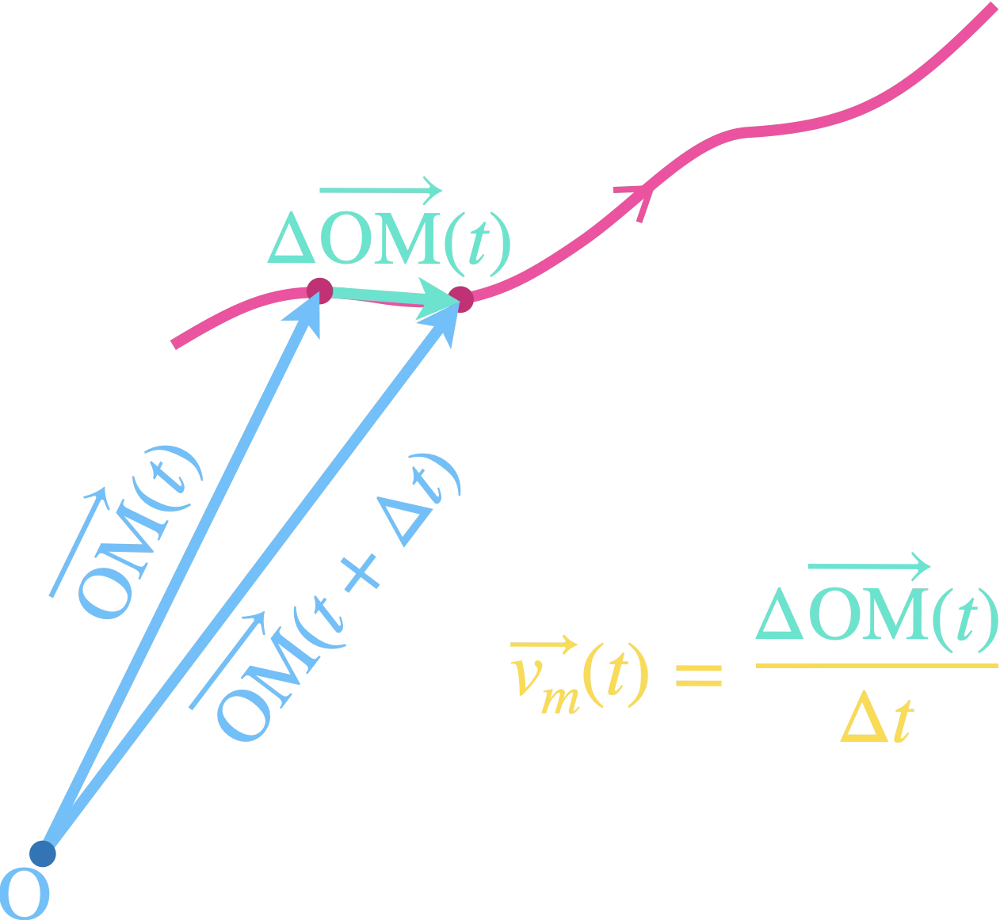
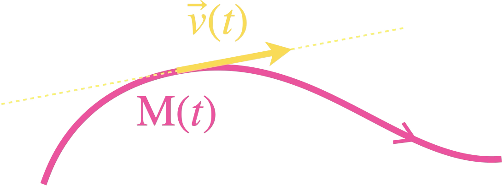
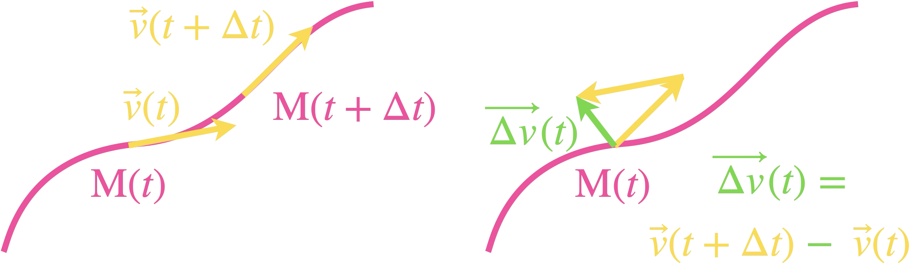
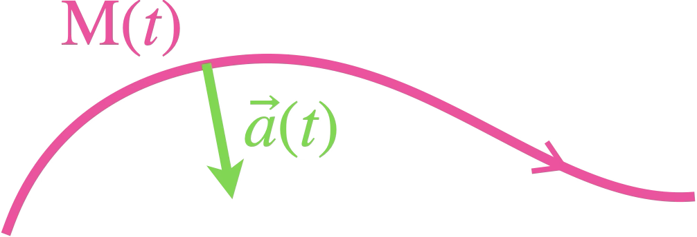
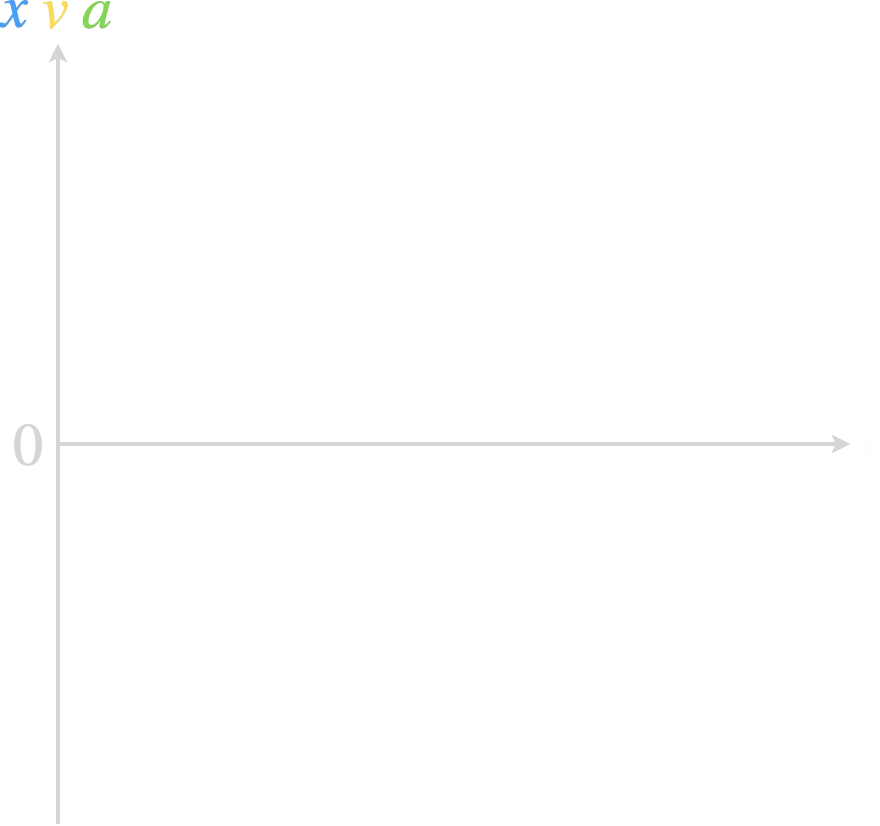

+++
title = "Mouvement"
outputs = ["Reveal"]
[reveal_hugo]
theme = "league"
highlight_theme = "atom-one-dark-reasonable"
+++

{}

# Cinématique

---

La cinématique est l'étude du mouvement.

---

Un mouvement s'étudie dans un référentiel.

 

Un référentiel est un solide (ensemble de points fixes entre eux) par rapport auquel on repère la position ou le mouvement.

---

Un référentiel est composé :

 

<ul>
<li class="fragment fade-up">d'un repère d'espace $(O;\vec{i},\vec{j},\vec{k})$ permettant de définir la position,</li>
 
<li class="fragment fade-up">d'un repère de temps ou horloge $(t)$ permettant d'associer une date à chaque position.</li>
</ul>

---

Référentiels usuels :

 

<ul>
<li class="fragment fade-up">Référentiel terrestre : tout solide immobile à la surface de la Terre.</li>
</ul>

---

<ul>
<li>Référentiel géocentrique : solide défini par le centre de la Terre et 3 étoiles lointaines considérées comme fixes.</li>
</ul>

---

<ul>
<li>Référentiel héliocentrique : solide défini par le centre du Soleil et 3 étoiles lointaines considérées comme fixes.</li>
</ul>

{}

---

{}

## Vecteur position

---



---

Dans un repère orthonormé $(0;\vec{i},\vec{j},\vec{k})$, la position d'un point $\mathrm{M}$ à la date $t$ est donnée par son <b style="color:#56C1FF;">vecteur position

$\overrightarrow{\mathrm{OM}}(t)\left(\begin{aligned}x(t)\\y(t)\\z(t)\end{aligned}\right)$

$\overrightarrow{\mathrm{OM}}(t)=x(t)\vec{i}+y(t)\vec{j}+z(t)\vec{k}$

</b>

---

On notera fréquemment :

<b style="color:#56C1FF">
$$
\begin{cases}
x(t)=\ldots\\
y(t)=\ldots\\
z(t)=\ldots
\end{cases}
$$
</b>

<u>Rq</u> : en pratique, les mouvements seront presque toujours à 2 dimensions seulement.
<b style="color:#56C1FF">
$$
\begin{cases}
x(t)=\ldots\\
y(t)=\ldots
\end{cases}
$$
</b>

---

La norme $\mathrm{OM}$(t) du vecteur position vaut :

$\mathrm{OM}(t)=||\overrightarrow{\mathrm{OM}}(t)||=\sqrt{x(t)^2+y(t)^2+z(t)^2}$

Unité : $\pu{m}$

{}

---

{}

## Vecteur vitesse

---

---

Le vecteur vitesse moyenne d'un point $\mathrm{M}$ entre deux instants $t$ et $t+\Delta t$ est défini par :

$
\begin{aligned}
\vec{v}_m(t) &= \frac{\overrightarrow{\mathrm{M}(t)\mathrm{M}(t+\Delta t)}}{\Delta t}\\
&= \frac{\overrightarrow{\mathrm{OM}(t+\Delta t)}-\overrightarrow{\mathrm{OM}(t)}}{\Delta t}\\
&=\frac{\overrightarrow{\Delta\mathrm{OM}(t)}}{\mathrm{\Delta}t}
\end{aligned}
$

---

On obtient le vecteur vitesse $\vec{v}(t)$ en faisant tendre $\Delta t$ vers $0$.

On obtient alors la dérivée du vecteur position.

---

Le <b style="color:#FFD932">vecteur vitesse $\vec{v}(t)$</b> d'un point $\mathrm{M}$ à la date $t$ est la <b style="color:#FFD932">dérivée par rapport au temps du vecteur position</b> :

$$\vec{v}(t)=\frac{\mathrm{d}\overrightarrow{\mathrm{OM}}}{\mathrm{d}t}$$

Notation : 
En physique, $\Delta$ correspond à une variation et $\mathrm{d}$ à une variation infinitésimale.

---

<b style="color:#FFD932">

$$
\begin{array}{rcrcrcr}
\vec{v}(t) & = & v_x(t)\, \vec{i} & + & v_y(t) \, \vec{j} & +  &v_z(t)  \, \vec{k}\\
& = &\frac{\mathrm{d}x}{\mathrm{d}t} \,\vec{i} & +& \frac{\mathrm{d}y}{\mathrm{d}t} \, \vec{j} & +  &\frac{\mathrm{d}z}{\mathrm{d}t} \, \vec{k}
\end{array}
$$

</b>

<b style="color:#FFD932" >

$$
\begin{cases}
v_x(t)=\frac{\mathrm{d}x}{\mathrm{d}t}=\ldots\\
v_y(t)=\frac{\mathrm{d}y}{\mathrm{d}t}=\ldots\\
v_z(t)=\frac{\mathrm{d}z}{\mathrm{d}t}=\ldots
\end{cases}
$$

</b>

<u>Rq</u> :
La notation physique $\frac{\mathrm{d}x}{\mathrm{d}t}$ correspond à la notation mathématique $x'(t)$.

---

Le vecteur vitesse est porté par la tangente à la trajectoire et orienté dans le sens du mouvement.

---

La norme $v$(t) du vecteur vitesse vaut :

$v(t)=||\vec{v}(t)||=\sqrt{v_x(t)^2+v_y(t)^2+v_z(t)^2}$

Unité : $\pu{m*s-1}$

{}

---

{}

## Vecteur accélération

---

---

---

Le vecteur accélération moyenne d'un point $\mathrm{M}$ entre deux instants $t$ et $t+\Delta t$ est défini à partir du vecteur variation de vitesse :

$
\begin{aligned}
\vec{a}_m(t) &= \frac{\vec{v}(t+\Delta t)-\vec{v}(t)}{\Delta t}\\\\
&= \frac{\Delta \vec{v}(t)}{\Delta t}
\end{aligned}
$

---

On obtient le vecteur accélération $\vec{a}(t)$ en faisant tendre $\Delta t$ vers $0$.

Cela donne la dérivée du vecteur vitesse et donc la dérivée seconde du vecteur position.

---

Le <b style="color:#61D836">vecteur accélération $\vec{a}(t)$</b> d'un point $\mathrm{M}$ à la date $t$ est la <b style="color:#61D836">dérivée par rapport au temps du vecteur vitesse</b> et <b style="color:#61D836">la dérivée seconde du vecteur position</b> :

 

$$
\begin{aligned}
\vec{a}(t)&=\frac{\mathrm{d}\vec{v}}{\mathrm{d}t}\\
&=\frac{\mathrm{d^2}\overrightarrow{\mathrm{OM}}}{\mathrm{d}t^2}
\end{aligned}
$$

---

<b style="color:#61D836">

$$
\begin{array}{rcrcrcr}
\vec{a}(t) & = & a_x(t)\, \vec{i} & + & a_y(t) \, \vec{j} & +  &a_z(t)  \, \vec{k}\\
& = &\frac{\mathrm{d}v_x}{\mathrm{d}t} \,\vec{i} & +& \frac{\mathrm{d}v_y}{\mathrm{d}t} \, \vec{j} & +  &\frac{\mathrm{d}v_z}{\mathrm{d}t} \, \vec{k}
\end{array}
$$

</b>

<b style="color:#61D836" >

$$
\begin{cases}
a_x(t)=\frac{\mathrm{d}v_x}{\mathrm{d}t}=\ldots\\
a_y(t)=\frac{\mathrm{d}v_y}{\mathrm{d}t}=\ldots\\
a_z(t)=\frac{\mathrm{d}v_z}{\mathrm{d}t}=\ldots
\end{cases}
$$

</b>

---

Le vecteur accélération est dans la direction et le sens du vecteur variation de vitesse. 

Dans le cas d'une trajectoire courbe, il pointe vers l'intérieur de la courbe.

---

La norme $a$(t) du vecteur accélération vaut :

$a(t)=||\vec{a}(t)||=\sqrt{a_x(t)^2+a_y(t)^2+a_z(t)^2}$

Unité : $\pu{m*s-2}$

---



{}

---

<iframe scrolling="no" title="Mouvement" src="https://www.geogebra.org/material/iframe/id/uk5ujj5u/width/650/height/650/border/888888/sfsb/true/smb/false/stb/false/stbh/false/ai/false/asb/false/sri/true/rc/true/ld/false/sdz/true/ctl/false" width="650px" height="650px" style="border:0px;"> </iframe>

---

{}

## Vidéos

---



Jusqu'à 3'22'' (la méthode d'Euler est introduite après, utile pour le supérieur mais pas au programme de Tspé)

---



Jusqu'à 4'51'' (mouvement circulaire uniforme décrit dans un repère orthonormé fixe = pas au programme)

{}

---

{}

## Mouvements rectilignes

---

Un mouvement est rectiligne si sa trajectoire est une droite.

Le vecteur vitesse conserve alors la même direction (celle du mouvement).

---

Si le vecteur vitesse est constant, le mouvement est dit rectiligne uniforme.

Que vaut alors le vecteur accélération ?

$$
\vec{a}=\frac{\mathrm{d}\vec{v}}{\mathrm{d}t}=\vec{0}
$$

MRU $\Leftrightarrow$ $\vec{a}=\vec{0}$

---

Tracer les évolutions de la position <b style="color:#00A2FF">$x(t)$</b>,  de la vitesse <b style="color:#FFD932">$v(t)$</b> et de l'accélération <b style="color:#61D836">$a(t)$</b> dans le cas où ${\color{#00A2FF}x(0)}<0$ et ${\color{#FFD932}v(0)}>0$.

<svg class="courbes-xva" viewBox="0 0 880 826" style="position:absolute;inset:0;width:100%;height:100%;overflow:visible;">
<line class="fragment trace" x1="57" y1="443.5" x2="812" y2="443.5" stroke="#7FD653" stroke-width="4" pathLength="1"/>
<line class="fragment trace" x1="57" y1="315.5" x2="812" y2="315.5" stroke="#F9DB59" stroke-width="4" pathLength="1"/>
<line class="fragment trace" x1="57" y1="630.8" x2="797" y2="160.3" stroke="#48A0F5" stroke-width="4" pathLength="1"/>
</svg>

---

$\vec{a}(t)=\overrightarrow{\text{cte}}$

Un mouvement rectiligne avec un vecteur accélération constant est dit rectiligne uniformément accéléré.

---

Tracer les évolutions de la position <b style="color:#00A2FF">$x(t)$</b>,  de la vitesse <b style="color:#FFD932">$v(t)$</b> et de l'accélération <b style="color:#61D836">$a(t)$</b> dans le cas où ${\color{#00A2FF}x(0)}>0$, ${\color{#FFD932}v(0)}>0$ et ${\color{#61D836}a}<0$.

<svg class="courbes-xva" viewBox="0 0 880 826" style="position:absolute;inset:0;width:100%;height:100%;overflow:visible;">
<line class="fragment trace" x1="57" y1="525.5" x2="812" y2="525.5" stroke="#80D754" stroke-width="4" pathLength="1"/>
<line class="fragment trace" x1="57" y1="280.4" x2="810" y2="633.6" stroke="#F8DC57" stroke-width="4" pathLength="1"/>
<path class="fragment trace" d="M57 380.6 L65 370.4 L69 365.3 L73 360.6 L77 355.6 L81 351.2 L85 346.7 L89 342.3 L93 337.5 L97 333.3 L101 329.1 L105 325.0 L109 320.8 L113 317.0 L117 313.0 L121 308.2 L125 304.7 L129 301.0 L133 297.6 L137 293.7 L141 290.5 L145 286.9 L149 283.4 L153 280.2 L157 276.9 L161 273.7 L165 270.7 L169 267.7 L173 264.8 L177 261.7 L181 258.9 L185 256.2 L189 253.7 L193 251.0 L197 248.2 L201 245.5 L205 243.2 L209 240.8 L213 238.4 L217 235.9 L221 233.9 L225 231.7 L229 229.6 L233 227.6 L237 225.7 L241 223.8 L245 221.9 L249 220.1 L253 218.3 L257 216.5 L261 214.9 L265 213.4 L269 212.0 L273 210.5 L277 209.1 L281 207.7 L285 206.4 L289 205.1 L293 203.9 L297 202.7 L301 201.6 L305 200.7 L309 199.7 L313 198.7 L317 197.8 L321 196.9 L325 196.1 L329 195.4 L333 194.9 L337 194.1 L341 193.5 L345 193.0 L349 192.5 L353 192.0 L357 191.8 L361 191.0 L365 191.0 L369 191.0 L373 190.7 L377 190.0 L381 190.0 L385 190.0 L389 190.0 L393 190.0 L397 190.0 L401 190.0 L405 190.7 L409 191.0 L413 191.0 L417 191.1 L421 191.9 L425 192.0 L429 192.5 L433 193.0 L437 193.4 L441 194.0 L445 194.6 L449 195.3 L453 196.0 L457 196.7 L461 197.4 L465 198.3 L469 199.3 L473 200.2 L477 201.1 L481 202.0 L485 203.2 L489 204.3 L493 205.3 L497 206.5 L501 207.7 L505 208.8 L509 210.2 L513 211.5 L517 212.9 L521 214.4 L525 215.8 L529 217.3 L533 218.9 L537 220.4 L541 222.0 L545 223.7 L549 225.3 L553 227.1 L557 228.9 L561 230.7 L565 232.6 L569 234.5 L573 236.5 L577 238.5 L581 240.5 L585 242.6 L589 244.7 L593 246.7 L597 249.0 L601 251.3 L605 253.5 L609 255.7 L613 258.1 L617 260.7 L621 263.0 L625 265.5 L629 268.0 L633 270.6 L637 273.2 L641 275.8 L645 278.7 L649 281.2 L653 284.0 L657 286.9 L661 289.7 L665 292.6 L669 295.6 L673 298.3 L677 301.6 L681 304.6 L685 307.7 L689 310.9 L693 314.1 L697 317.3 L701 320.6 L705 323.9 L709 327.2 L713 330.8 L717 334.0 L721 337.7 L725 341.2 L729 345.0 L733 348.7 L737 352.0 L741 355.9 L745 359.9 L749 364.0 L753 367.7 L757 371.5 L761 375.5 L765 379.5 L769 383.7 L773 388.0 L777 392.1 L781 396.5 L785 400.7 L789 405.3 L793 409.6 L797 414.3 L801 418.5 L805 423.3 L809 427.9 L818 438.2" fill="none" stroke="#48A0F5" stroke-width="4" stroke-linejoin="round" pathLength="1"/>
</svg>

---

<iframe scrolling="no" title="xva" src="https://www.geogebra.org/material/iframe/id/dpm6zhuu/width/720/height/506/border/888888/sfsb/true/smb/false/stb/false/stbh/false/ai/false/asb/false/sri/true/rc/true/ld/false/sdz/false/ctl/false" width="720px" height="506px" style="border:0px;border-radius:10px;"> </iframe>

---

Petit exercice :

---

Avant d'aborder le virage des combes (5) du circuit de Spa-Francorchamps, un pilote de F1 freine fortement pour passer sa vitesse de 327 km/h à 176 km/h en 1,48 s.

En supposant le mouvement rectiligne uniformément accéléré, décrire le vecteur accélération de la F1.

Sur combien de mètres a lieu le freinage ?

Il se fait en réalité sur 93 m, que peut-on conclure ?

{}

---

{}

## Mouvements circulaires

---

Un mouvement est circulaire si sa trajectoire est un cercle (ou un arc de cercle).

On parle de mouvement circulaire uniforme si la norme du vecteur vitesse est constante.

---

Pour décrire le mouvement circulaire d'un point M sur un cercle de centre O, on utilise un repère de Frenet.

---

C'est un repère mobile centré au point étudié M et de vecteurs unitaires :

<ul>
<li class="fragment fade-up"><b style="color:#FFD932">$\vec{u}_T$ : vecteur tangent</b> $\hphantom{\vec{u_t}}$&nbsp;&nbsp;&nbsp;tangent à la trajectoire, $\hphantom{\vec{u_t}}$&nbsp;&nbsp;&nbsp;orienté dans le sens du mouvement</b></li>
<li class="fragment fade-up"><b style="color:#61D836">$\vec{u}_N$ : vecteur normal</b> $\hphantom{\vec{u_n}}$&nbsp;&nbsp;&nbsp;de direction (OM) $\hphantom{\vec{u_n}}$&nbsp;&nbsp;&nbsp;orienté vers le centre O</li>
</ul>

<u>Rq</u> : $\vec{u}_T$ est parfois noté $\vec{T}$ et $\vec{u}_N$ noté $\vec{N}$.

---

<iframe scrolling="no" title="Frenet" src="https://www.geogebra.org/material/iframe/id/njrcnku6/width/488/height/468/border/888888/sfsb/true/smb/false/stb/false/stbh/false/ai/false/asb/false/sri/true/rc/true/ld/false/sdz/false/ctl/false" width="488px" height="468px" style="border:0px;border-radius:10px;"> </iframe>

---

Dans le repère de Frenet $(\mathrm{M};\vec{u}_T,\vec{u}_N)$, le <b style="color:#FFF056">vecteur vitesse</b> se décompose en :

$$
\vec{v}(t)
\begin{cases}
v_T(t)=v(t)\\
v_N(t)=0
\end{cases}
$$

Finalement : 
$\vec{v}(t)=v(t)\,\vec{u}_T$

---

Et le <b style="color:#61D836">vecteur accélération</b> :

$$
\vec{a}(t)
\begin{cases}
a_T(t)=\frac{\mathrm{d}v}{\mathrm{d} t}\\
a_N(t)=\frac{v^2}{R}
\end{cases}
$$

Finalement : 
$\vec{a}(t)=\frac{\mathrm{d}v}{\mathrm{d} t}\,\vec{u}_T + \frac{v^2}{R}\,\vec{u}_N$

---

<iframe scrolling="no" title="Mouvement circulaire" src="https://www.geogebra.org/material/iframe/id/rjynsa48/width/676/height/537/border/888888/sfsb/true/smb/false/stb/false/stbh/false/ai/false/asb/false/sri/true/rc/true/ld/false/sdz/false/ctl/false" width="676px" height="537px" style="border:0px;border-radius:10px;"> </iframe>

---

Et si le mouvement est circulaire uniforme ?

On a $\frac{\mathrm{d}v}{\mathrm{d}t}=0$ puisque $v=\mathrm{cte}$

Et donc :

$$
\vec{a}(t)
\begin{cases}
a_T(t)=0\\\\
a_N(t)=\frac{v^2}{R}
\end{cases}
$$

$\vec{a}(t)= \frac{v^2}{R}\,\vec{u}_N$

---

L'accélération est centripète (dirigée vers le centre) et de norme constante.

{}

---

[Retour site](https://coursphychi.github.io/tspe/mouvement/)