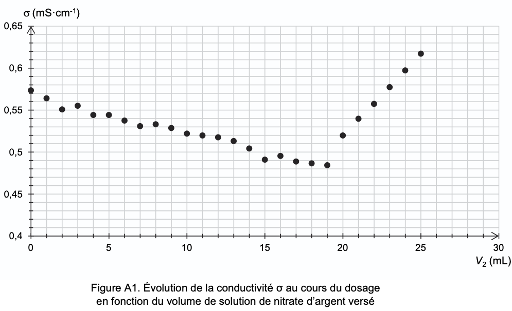
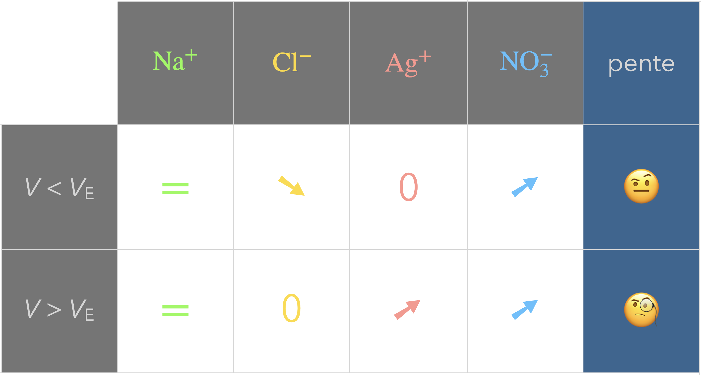
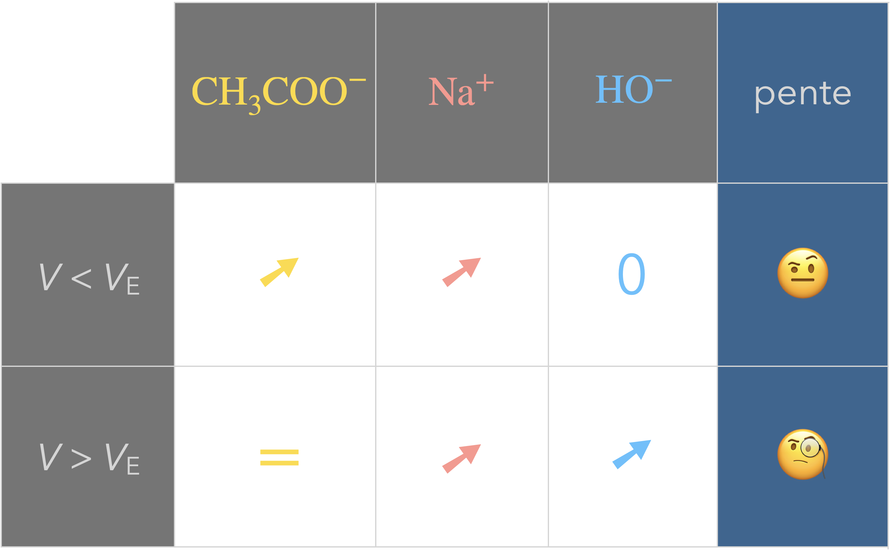

+++
title = "Titrages"
outputs = ["Reveal"]
[reveal_hugo]
theme = "league"
highlight_theme = "atom-one-dark-reasonable"
+++

{}

# Titrages

---

Les titrages sont des méthodes de dosage (détermination d'une quantité de matière inconnue) destructive utilisant une transformation chimique.

---

La réaction support d'un titrage doit être :

<ul>
<li class="fragment fade-up imp">totale</li>
<li class="fragment fade-up imp">rapide</li>
<li class="fragment fade-up imp">unique</li>
</ul>

---

<u>Rq</u> : 

en première, la réaction support du titrage était une <pan class="fragment">oxydoréduction.

---

## Montage :

---



---



---

La détermination de la quantité de matière du réactif titré repose sur le répérage de l'équivalence. 

---

<u>Rq</u> :

En première, le repérage de l'équivalence se fait par suivi colorimétrique.

---

<ul>
<li>Avant l'équivalence : le titrant est limitant</li>
 
<li>À l'équivalence : il y a changement de réactif limitant</li>
 
<li>Après l'équivalence : le titré est limitant
</li>
</ul>

---

Supposons que la réaction support du titrage est :

$$\ce{a A + b B -> \ldots}$$

où A est le réactif titré et B est le réactif titrant.

---

Comment évoluent les quantités de matière dans le mélange réactionnel en fonction du volume de titrant ajouté ?

---



---

À l'équivalence, le mélange est en proportions stœchiométriques :

 

$$
\frac{n_\ce{A_\text{initial}}}{a}=\frac{n_{\ce{B}_\text{versé à l'équivalence}}}{b}
$$

---

$$
\frac{C_\mathrm{A} V_\mathrm{A}}{a}=\frac{C_\mathrm{B} \color{#FFF056}V_E}{b}
$$

---

En terminale, on ajoute les réactions acide-base comme support de titrage et deux types de suivi :

<ul>
<li class="fragment fade-up imp">pH-métrique</li>
<li class="fragment fade-up imp">conductimétrique</li>
</ul>

{}

---

{}

## Titrage pH-métrique

---

La réaction support du titrage est une réaction acide-base et le suivi est pH-métrique (on relève le pH en fonction du volume de titrant ajouté).

---



---

Le repérage de l'équivalence se fait après coup (on ne s'arrête pas à l'équivalence).

Le passage par l'équivalence correspond à un saut de pH sur la courbe $\mathrm{pH}=f(V_B)$ obtenue.

{}
L'utilisation d'un indicateur coloré d'acidité peut permettre de repérer le saut sur un premier titrage rapide. On recommence ensuite le titrage en augmentant la précision autour du saut.
{}

---



---

Deux méthodes permettent de repérer précisément $V_E$ :

<ul>
<li class="fragment fade-up imp">la méthode de la dérivée</li>
<li class="fragment fade-up imp">la méthode des tangentes</li>
</ul>

---

### Méthode de la dérivée

 

La dérivée de $\mathrm{pH}(V_B)$ passe par un maximum au niveau du saut (point d'inflexion). 

---



---

### Méthode des tangentes

---



{}

---

{}

## Titrage conductimétrique

---

Comme son nom l'indique, un tel titrage est suivi par conductimétrie.

---



---

<u>Principe</u> :

Si les conductivités du titrant et du titré sont différentes, l'équivalence sera repérable par une rupture de pente dans la courbe $\sigma=f(V_B)$.

---



---



---

<u>Méthode pour déterminer l'équivalence</u> :

On trace les deux droites obtenues en excluant les points trop près de la rupture. Les coordonnées du point d'intersection donne le volume équivalent et la conductivité à l'équivalence.

---



---

Exemple d'une courbe donnée à l'exercice "Eau de Quinton" tombé en 2025

  
  

{}
V_E = 18,0 mL
{}

---

⚠️

L'ajout du volume de titrant dilue la solution, ce qui influe sur la conductivité. 

Pour atténuer l'impact, on ajoute une large quantité d'eau à la solution titrée.

La petite dilution due au titrant devient moins sensible.

---



---

Exemple du titrage d'une solution de chlorure de sodium $\ce{(Na+ + Cl^-)}$ par une solution de nitrate d'argent $\ce{(Ag+ + NO3^-)}$.

$$\ce{Ag+ + Cl- -> AgCl}$$

Données :

<ul style="color:#aaa;">
<li style="color:#aaa;">$\lambda_\ce{Na+}=\pu{5,0 mS*m^2*mol-1}$</li>
<li style="color:#aaa;">$\lambda_\ce{Cl-}=\pu{7,6 mS*m^2*mol-1}$</li>
<li style="color:#aaa;">$\lambda_\ce{Ag+}=\pu{6,2 mS*m^2*mol-1}$</li>
<li style="color:#aaa;">$\lambda_\ce{NO3^-}=\pu{7,1 mS*m^2*mol-1}$</li>
</ul>

{}
1 mS m2 mol−1 = 10 mS cm−1 L mol−1
Ce n'est pas une réaction acide-base mais une réaction de précipitation (mais ça peut arriver si données).
{}

---

Prévoir la courbe de titrage obtenue.

 

 

 

---

Exemple du titrage d'une solution d'acide éthanoïque $\ce{CH3COOH (aq)}$ par une solution d'hydroxyde de sodium $\ce{(Na+ + HO^-)}$.

 

Données :

<ul style="color:#aaa;">
<li style="color:#aaa;">$\lambda_\ce{Na+}=\pu{5,0 mS*m^2*mol-1}$</li>
<li style="color:#aaa;">$\lambda_\ce{HO-}=\pu{19,9 mS*m^2*mol-1}$</li>
<li style="color:#aaa;">$\lambda_\ce{CH3COO-}=\pu{4,1 mS*m^2*mol-1}$</li>
</ul>

---

Prévoir la courbe de titrage obtenue.

 

 

 

{}

---

{}

# Densité d'une solution et titre massique

---

<b style="color:#56C1FF;">Densité $d$ d'une solution</b> :

 

$$
d=\frac{\rho_\text{solution}}{\rho_\text{eau}}
$$

 

Unité ?

---

Le titre massique $w$ d'un soluté est le quotient de la masse de soluté apporté par la masse de solution :

 

$$
w=\frac{m_\text{soluté}}{m_\text{solution}}
$$

 

Unité ?

---

On exprime souvent le titre en pourcentage.

On l'appelle d'ailleurs parfois pourcentage massique mais il peut aussi être appelé teneur massique.

{}
Souvent exprimé en pourcentage ou défini comme la masse de X pour 100 g de solution (mais attention, pas une masse !!)
{}

---

Comment passe-t-on de la concentration en quantité de matière $C$ au titre massique $w$ ?

🤔

---

Pour un volume $V$ de solution, la masse de soluté vaut :

$m_\text{soluté} = C\times V\times M$ 

Et le volume $V$ de solution a une masse :

$m_\text{solution} = V\times \rho_\text{solution} = V\times d_\text{solution} \times \rho_\text{eau}$  

$$
\begin{aligned}
\Rightarrow w=\frac{m_\text{soluté}}{m_\text{solution}}&=\frac{C\times \bcancel{V}\times M}{\bcancel{V}\times d_\text{solution} \times \rho_\text{eau}}\\
&=\frac{C \times M}{ d_\text{solution} \times \rho_\text{eau}}\\
&=\frac{C \times M}{ \rho_\text{solution} }
\end{aligned}
$$

{}

---

[Retour site](https://coursphychi.github.io/tspe/titrages/)